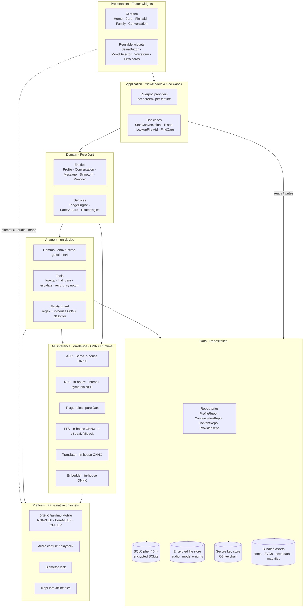
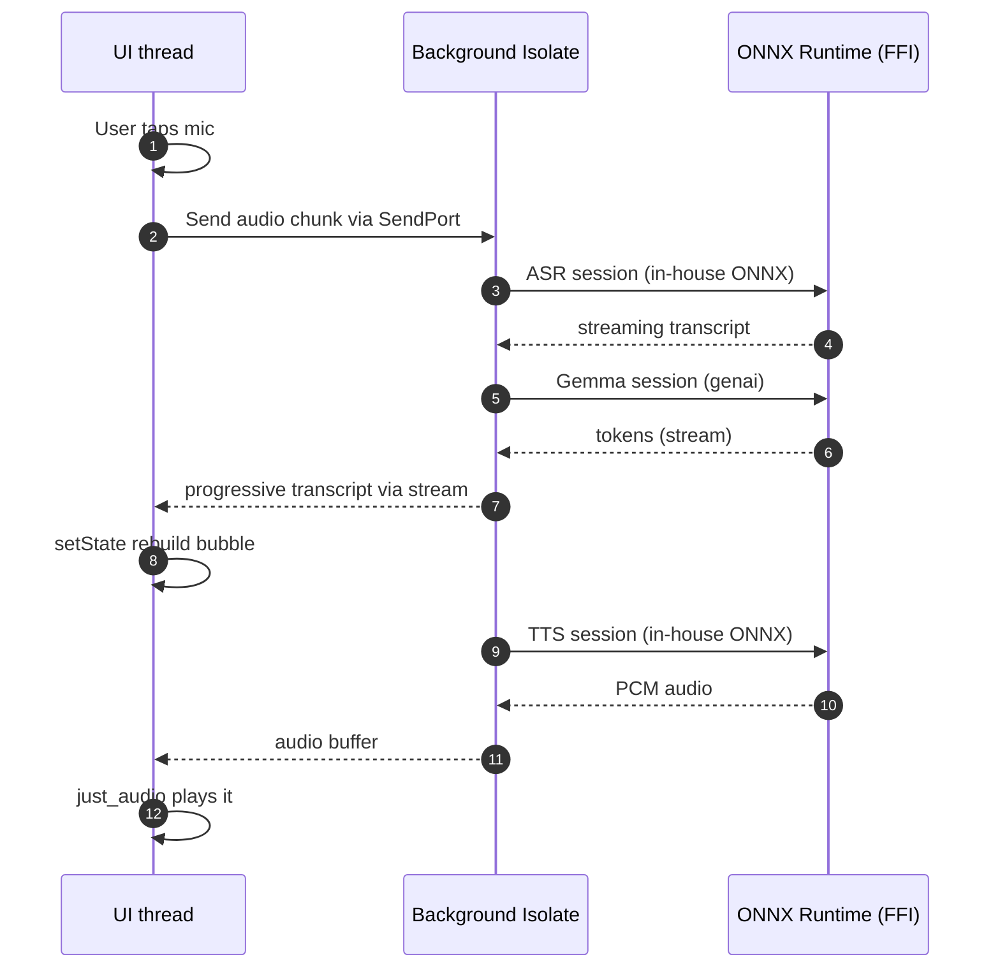

# 01 — System Architecture

How Sema is layered on a single device. **There is no backend in v1.** Every
arrow on this diagram terminates inside the phone.

## High-level diagram

## Layer responsibilities

| Layer | Owns | Doesn't own |
|---|---|---|
| **Presentation** | Pixels, animations, gestures, accessibility | Business rules, persistence, ML calls |
| **Application** | Orchestrating use cases, exposing reactive state to widgets | Direct DB access, model file paths |
| **Domain** | Plain Dart entities + pure services. No Flutter, no I/O. | Anything async-with-side-effects |
| **Data** | Repositories that hide whether something is in DB, file, bundled, or computed | Business rules |
| **ML** | Loading models, running inference, returning structured results | Conversation memory, persistence |
| **AI** | Agent loop, tool dispatch, prompt assembly, safety enforcement | Raw model I/O (delegates to ML), persistence (delegates to Data) |
| **Platform** | FFI bridges, OS APIs (audio, biometric, file system, maps) | Anything Dart-only |

The **strict rule**: a layer may only depend on layers below it on the
diagram. The Presentation layer never touches the DB; the AI agent never
calls Flutter. This is the only rule that keeps the codebase from rotting.

## Component map

### Presentation
- **Screens** — one per route (`HomeScreen`, `NearbyScreen`, etc.). Already implemented.
- **Reusable widgets** — `SemaButton`, `PressScale`, `Waveform`, etc. Pure Stateless or Stateful with local state only.
- **Theme** — `SemaTheme`, `SemaColors`, `SemaAccent`. Already implemented.

### Application (Riverpod providers)
- `currentProfileProvider` — which family member is active.
- `activeConversationProvider` — the conversation in focus.
- `triageOrchestratorProvider` — runs ASR → NLU → LLM → TTS for one user turn.
- `nearbyProvidersProvider` — filtered + sorted provider list.
- `routesProvider(providerId)` — lazy-computed routes per travel mode.

### Domain
- **Entities** — see [02 — Data model](02-data-model.md) for the shapes.
- `TriageEngine` — turns symptoms + history into a `TriageOutcome` (severity, recommended action).
- `SafetyGuard` — pure rules that intercept LLM output ("if model says 'take this drug', reject").
- `RouteEngine` — picks/generates routes for a provider given a travel mode.

### Data
- **Repositories** wrap data sources behind interfaces. The UI never knows whether a `Profile` came from RAM, from SQLite, or from a JSON seed.
- **DB** — Drift over SQLCipher. Schemas + migrations colocated with each entity.
- **Files** — encrypted audio clips and any per-user binary blobs.
- **Bundled assets** — fonts, SVGs, seed first-aid guides, seed providers, map tiles.
- **Secure storage** — DB encryption key, biometric-protected.

### ML & AI
See [04 — ML + AI](04-ml-and-ai.md) for full detail. They live as services
behind clean Dart interfaces; the rest of the app never imports `ffi` or the
runtime libs directly.

## Threading model

**Decision:** all heavy ML work runs in a long-lived background `Isolate`.
The UI thread only sends/receives messages. This keeps the 60 fps animations
crisp during inference. The cost is one isolate-resident pool of ORT
sessions (one per model) holding the loaded weights — a worthwhile tradeoff
vs reloading weights per turn.

## Module boundaries — what never crosses what

- **No Flutter imports in `lib/domain/` or `lib/data/`.** Domain stays pure Dart.
- **No `dart:io` in `lib/widgets/`.** Widgets stay deterministic; testable.
- **No `ffi` or ORT imports outside `lib/platform/`.** All native calls funnel through one folder.
- **No SQL strings outside `lib/data/db/`.** The rest of the codebase speaks Drift's typed query API.

## Failure isolation

Every async boundary (`Future`, isolate hop, FFI call) returns a `Result<T, SemaError>`
rather than throwing. This means:

- A model that fails to load doesn't take down the screen — it surfaces a
  friendly fallback.
- An OOM during inference falls back to a smaller model.
- A missing permission shows a "let me explain why we need this" sheet rather
  than a crash dialog.
