# 02 — Data Model

The full ERD plus every entity's purpose, keys, and the encryption rules.
Everything lives in **one local SQLite database**, encrypted at rest with
SQLCipher. Per-profile isolation is logical (foreign keys), not physical
(separate DBs) — chosen for simplicity; revisit if multi-tenant requirements
surface.

## ERD

```mermaid
erDiagram
    PROFILE ||--o{ CONVERSATION       : has
    PROFILE ||--o{ HEALTH_RECORD      : has
    PROFILE ||--o{ MEDICATION         : takes
    PROFILE ||--o{ REMINDER           : owns
    PROFILE ||--o{ AUDIT_EVENT        : produces

    CONVERSATION ||--o{ MESSAGE       : contains
    CONVERSATION ||--o| TRIAGE_OUTCOME: produces
    CONVERSATION }o--o{ SYMPTOM       : "via CONVERSATION_SYMPTOM"

    MESSAGE ||--o| AUDIO_CLIP         : may_have
    MESSAGE ||--o| TRANSCRIPT         : may_have

    MEDICATION ||--o{ MEDICATION_LOG  : has
    REMINDER }o--|| MEDICATION        : may_link

    PROVIDER }o--o{ TAG               : "via PROVIDER_TAG"
    PROVIDER ||--o{ ROUTE             : has
    ROUTE ||--o{ ROUTE_STEP           : has

    FIRST_AID_GUIDE ||--o{ FIRST_AID_STEP : has
    FIRST_AID_GUIDE }o--o{ SYMPTOM        : "via GUIDE_SYMPTOM"

    APP_SETTING ||--|| DEVICE         : "single row"

    PROFILE {
        TEXT id PK
        TEXT name
        TEXT initial
        INTEGER age
        TEXT relation
        TEXT language_code
        TEXT accent_key
        INTEGER is_active
        INTEGER created_at
        INTEGER updated_at
    }

    CONVERSATION {
        TEXT id PK
        TEXT profile_id FK
        TEXT title
        TEXT summary
        INTEGER started_at
        INTEGER ended_at
        TEXT status "draft|complete|escalated"
    }

    MESSAGE {
        TEXT id PK
        TEXT conversation_id FK
        INTEGER seq
        TEXT sender "user|sema"
        TEXT kind "text|voice|tool"
        TEXT body
        INTEGER created_at
    }

    AUDIO_CLIP {
        TEXT id PK
        TEXT message_id FK
        TEXT path
        INTEGER duration_ms
        INTEGER bytes
        TEXT cipher_iv
    }

    TRANSCRIPT {
        TEXT id PK
        TEXT message_id FK
        TEXT lang_code
        TEXT raw_text
        TEXT translated_text
        REAL confidence
    }

    TRIAGE_OUTCOME {
        TEXT id PK
        TEXT conversation_id FK
        TEXT severity "low|medium|high|emergency"
        TEXT recommendation
        TEXT escalation_target
        REAL confidence
        INTEGER created_at
    }

    SYMPTOM {
        TEXT id PK
        TEXT slug
        TEXT canonical_name
        TEXT body_system
    }

    CONVERSATION_SYMPTOM {
        TEXT conversation_id FK
        TEXT symptom_id FK
        REAL confidence
        INTEGER first_seen_at
    }

    FIRST_AID_GUIDE {
        TEXT id PK
        TEXT slug
        TEXT title
        TEXT subtitle
        TEXT category
        INTEGER duration_seconds
        TEXT accent_key
        TEXT icon_key
    }

    FIRST_AID_STEP {
        TEXT id PK
        TEXT guide_id FK
        INTEGER seq
        TEXT instruction
        TEXT audio_path
        INTEGER hold_seconds
    }

    GUIDE_SYMPTOM {
        TEXT guide_id FK
        TEXT symptom_id FK
    }

    PROVIDER {
        TEXT id PK
        TEXT name
        TEXT role
        REAL lat
        REAL lng
        TEXT phone
        INTEGER is_open_now
        TEXT hours_json
        TEXT accent_key
        INTEGER updated_at
    }

    TAG {
        TEXT id PK
        TEXT label
        TEXT kind "language|specialty|hours"
    }

    PROVIDER_TAG {
        TEXT provider_id FK
        TEXT tag_id FK
    }

    ROUTE {
        TEXT id PK
        TEXT provider_id FK
        TEXT mode "walk|drive|transit"
        TEXT eta
        TEXT distance
    }

    ROUTE_STEP {
        TEXT id PK
        TEXT route_id FK
        INTEGER seq
        TEXT icon_key
        TEXT instruction
        TEXT distance
    }

    HEALTH_RECORD {
        TEXT id PK
        TEXT profile_id FK
        TEXT kind "vitals|measurement|observation"
        TEXT data_json
        INTEGER recorded_at
    }

    MEDICATION {
        TEXT id PK
        TEXT profile_id FK
        TEXT name
        TEXT dosage
        TEXT frequency
        INTEGER active
        INTEGER started_at
    }

    MEDICATION_LOG {
        TEXT id PK
        TEXT medication_id FK
        TEXT profile_id FK
        INTEGER taken_at
        INTEGER skipped
    }

    REMINDER {
        TEXT id PK
        TEXT profile_id FK
        TEXT medication_id FK
        TEXT title
        TEXT cron
        INTEGER next_fire_at
        INTEGER active
    }

    AUDIT_EVENT {
        TEXT id PK
        TEXT profile_id FK
        TEXT kind
        TEXT detail_json
        INTEGER occurred_at
    }

    APP_SETTING {
        INTEGER id PK
        TEXT current_profile_id FK
        INTEGER biometric_lock
        INTEGER analytics_optin
        INTEGER backup_optin
        INTEGER schema_version
    }

    DEVICE {
        TEXT id PK
        TEXT install_token
        TEXT platform
        INTEGER first_seen_at
    }
```



## Entity glossary

### People & sessions

- **Profile** — a family member. The "active" profile drives every screen
  and every conversation. Stored alongside their preferred language and
  accent so the UI greets them correctly when switched in.
- **Conversation** — one session of talking to Sema. Has a title (first
  utterance excerpt) and a summary (LLM-generated when closed).
- **Message** — one bubble. `kind = tool` is reserved for tool-call traces
  (e.g. "Sema looked up first aid for burns") which render as small inline
  affordances rather than chat bubbles.
- **AudioClip** — encrypted PCM/Opus on disk; `path` is relative to the
  encrypted file store (see [05](05-offline-privacy.md)). `cipher_iv` is the
  per-clip IV; the master key lives in OS keychain.
- **Transcript** — ASR output. Stored alongside the message for replay,
  search, and to allow the user to correct misrecognitions.

### Triage knowledge

- **Symptom** — controlled vocabulary (`fever`, `cough`, `bleeding-heavy`).
  Seeded from the bundled taxonomy (~300 entries for v1, mapped to ICD-11
  chapters for future portability).
- **TriageOutcome** — what the AI concluded after a conversation. Severity
  drives downstream UI ("emergency" surfaces a red banner with "go now").
- **FirstAidGuide / FirstAidStep** — the offline curriculum. Each guide is
  symptom-tagged so the LLM agent can retrieve the right one at the right
  moment.

### Care discovery

- **Provider** — a clinician, midwife, pharmacy, hospital. `is_open_now` is
  recomputed from `hours_json` on read; the column is denormalized for fast
  filtering on the chip strip.
- **Tag** — language/specialty/hours metadata. Many-to-many because a
  midwife may speak Twi + English + Ga.
- **Route / RouteStep** — turn-by-turn directions per travel mode. Cached
  on first computation; recomputed if the user changes start point.

### Care delivery

- **HealthRecord** — vitals, measurements, observations the user records
  manually (or imports from a device). Schema-light by design — `data_json`
  holds shape-specific fields.
- **Medication / MedicationLog** — what's been prescribed and what the
  family member has actually taken.
- **Reminder** — cron-style alarms tied to either a medication or a custom
  task ("check Yaa's blood pressure tomorrow").

### Operational

- **AuditEvent** — append-only log of significant actions (profile created,
  data wiped, biometric unlock failed). Used for the user's own privacy
  review screen, not telemetry.
- **AppSetting** — single-row table with the device-wide settings.
- **Device** — single-row table for device-scoped identifiers; never
  transmitted unless the user opts into encrypted backup.

## Indices that matter

```sql
CREATE INDEX message_conv_seq      ON message(conversation_id, seq);
CREATE INDEX conv_profile_started  ON conversation(profile_id, started_at DESC);
CREATE INDEX provider_open         ON provider(is_open_now);
CREATE INDEX provider_geo          ON provider(lat, lng);
CREATE INDEX reminder_next_fire    ON reminder(next_fire_at) WHERE active = 1;
CREATE INDEX symptom_slug          ON symptom(slug);
```

The geospatial index is just lat/lng for v1 — providers count is small
(< 1000 per region) so a linear filter in Dart after the bounding-box query
is faster than wiring R-tree.

## Encryption rules

- **DB:** SQLCipher. Master key is 256-bit, generated on first launch,
  stored in `flutter_secure_storage` (which uses Keychain on iOS / KeyStore
  on Android).
- **Audio clips:** AES-256-GCM with per-clip IV. Same master key as DB.
- **Bundled assets:** **not encrypted** (they're public read-only seeds —
  fonts, SVGs, first-aid text/audio).
- **Backups (opt-in, future):** envelope-encrypted with a user-chosen
  passphrase. Backup blob is zero-knowledge — Sema's makers cannot decrypt.

## Migration strategy

- Schema version stored in `app_setting.schema_version`.
- Each migration is a forward-only Drift `MigrationStrategy.from(N).to(N+1)`.
- Migrations must:
  - Be deterministic and idempotent.
  - Avoid blocking the UI for > 200 ms; long ones run on launch with a "we're updating your data — your conversations are safe" splash.
  - Never drop user-generated tables.

## Sample queries

```dart
// All providers within a 3 km bounding box, sorted by distance, that the
// active profile's language can reach (i.e. tagged with their language).
final lat = profile.lat, lng = profile.lng;
final providers = await db.providers.select()
  ..where((p) => p.lat.isBetween(lat - 0.027, lat + 0.027))
  ..where((p) => p.lng.isBetween(lng - 0.027, lng + 0.027))
  ..join([
    innerJoin(providerTag, providerTag.providerId.equalsExp(provider.id)),
    innerJoin(tag, tag.id.equalsExp(providerTag.tagId)),
  ])
  ..where((_, t) => t.kind.equals('language') & t.label.equals('Twi'))
  .get();

// The conversation feed for the active profile, newest first, joined with
// its triage outcome (if any) for the row badge.
db.conversations.select()
  .join([leftOuterJoin(triage, triage.conversationId.equalsExp(conv.id))])
  .where((conv, _) => conv.profileId.equals(activeProfileId))
  .orderBy([OrderingTerm.desc(conv.startedAt)])
  .get();
```

## What's deliberately NOT in the model

- **No user accounts.** There is no `User` table. A "user" is whoever is
  holding the phone; the active `Profile` is the closest concept.
- **No remote IDs.** No `server_id`, `synced_at` etc. in v1. If sync ships,
  it'll be encrypted blob-level, not row-level — keeps the schema clean.
- **No granular permissions** (RBAC). The biometric lock + active profile is
  the access model.
