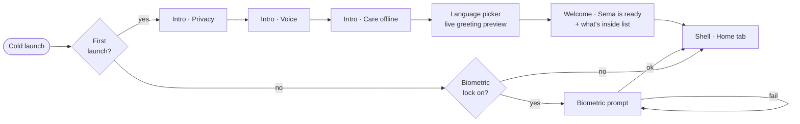
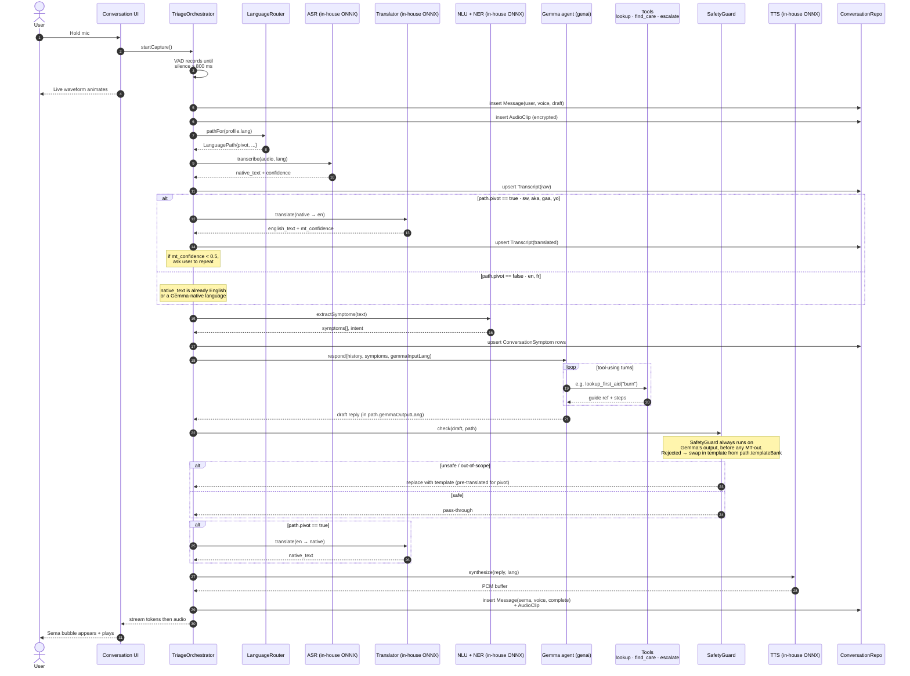
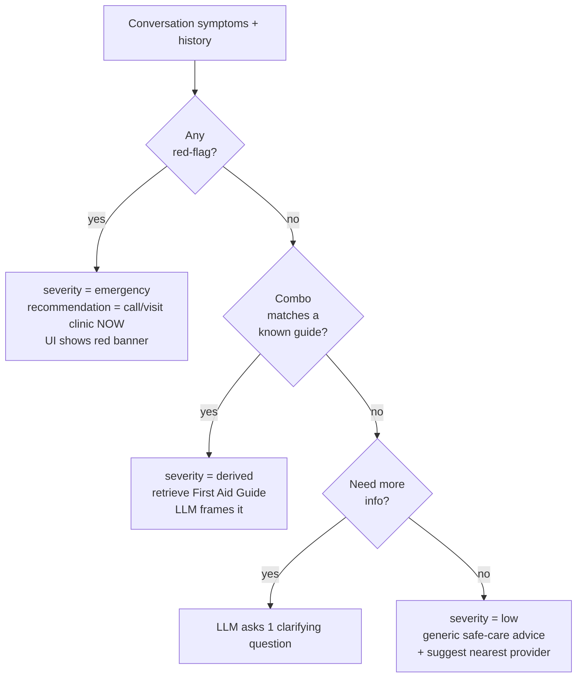
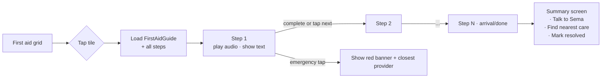
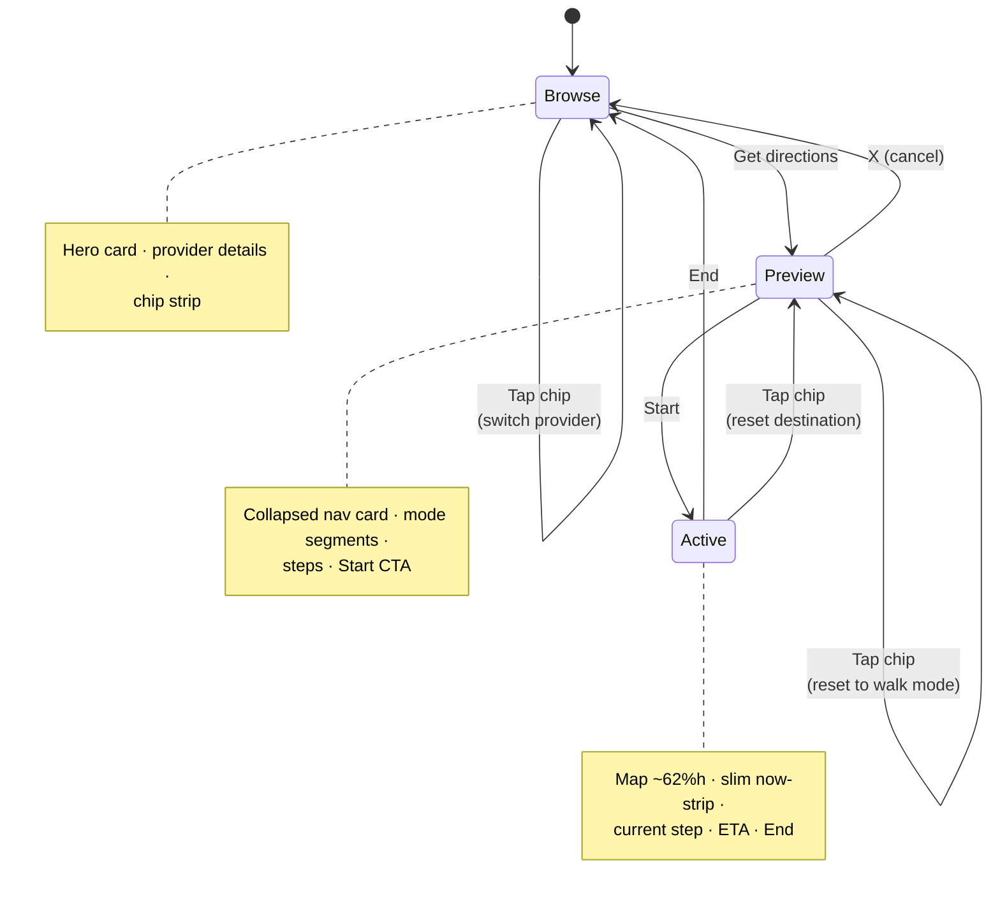
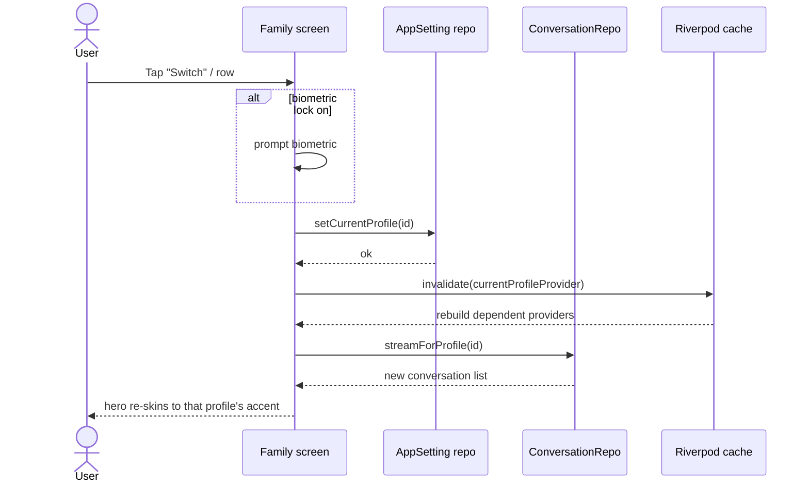
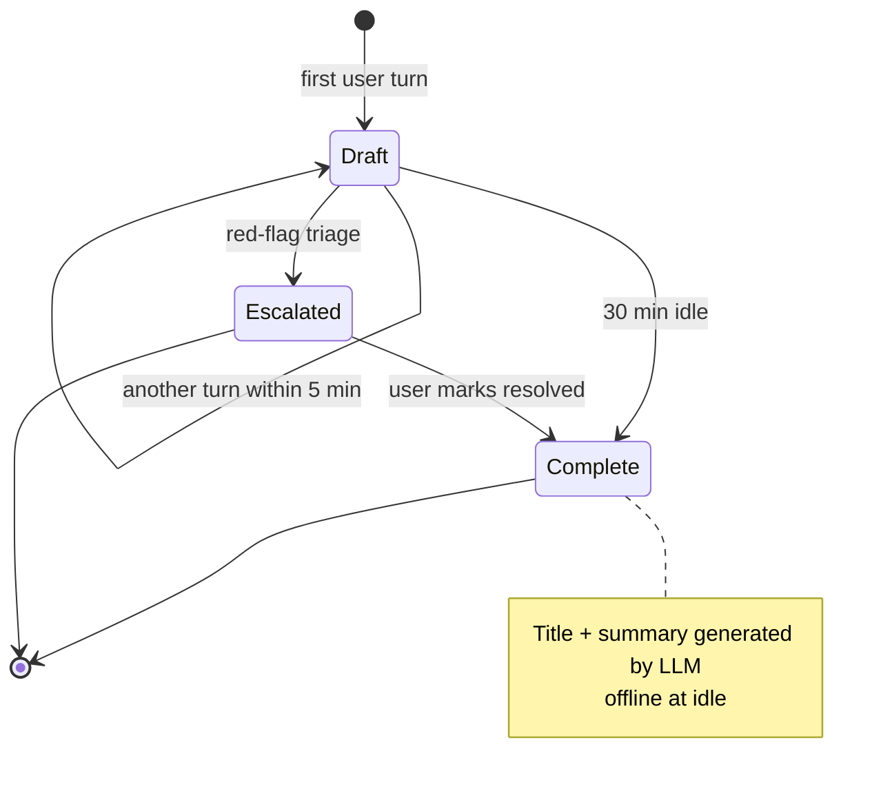

# 03 — Flows

Every important user journey, drawn. Use these as the source-of-truth when
implementing or reviewing a screen — if the code disagrees with the diagram,
one of them is wrong.

---

## Onboarding (cold start → main app)

The user opens Sema for the first time. They go through three intro pages,
pick a language with live preview, hit a confirmation screen, and land in
the shell. Already implemented as `IntroCarouselScreen` →
`LanguagePickerScreen` → `WelcomeScreen` → `ShellScreen`.

**Side effects on completion of onboarding:**
- `Profile` row created (the user, marked `is_active = 1`).
- `app_setting.current_profile_id` set.
- Default language saved to that profile.
- First-run model download kicked off in the background (see [05](05-offline-privacy.md)).

---

## Voice triage conversation (the core loop)

The user taps the mic on the home hero card or in the conversation screen,
speaks, and gets a calm reply in their language. Every step is local.

The orchestrator first asks the **LanguageRouter** which path this
language takes (direct vs pivot via English), then runs the
corresponding pipeline. The safety guard always sits on **Gemma's
output, before any translation-out** — rejected content never reaches
MT-out.

**Performance budget per turn (target on a mid-tier Android):**

| Stage | Budget |
|---|---|
| ASR (5-second clip) | ≤ 1.5 s |
| Translate (if needed) | ≤ 0.4 s |
| NLU + symptom extract | ≤ 0.2 s |
| LLM first token | ≤ 1.0 s |
| LLM full reply (≤ 60 tokens) | ≤ 3.0 s |
| TTS (≤ 60 tokens of speech) | ≤ 1.5 s |
| **End-to-end (perceived)** | **≤ 4 s to first speech** |

We stream LLM tokens to the UI so the user sees a typing reply long before
TTS starts.

---

## Triage decision tree

What `TriageEngine` does with extracted symptoms before the LLM speaks. This
is **rule-based first, LLM second** — a deterministic safety net.

**Red-flag rules** (non-exhaustive, all bundled JSON):
- `bleeding-heavy`, `chest-pain-acute`, `breathing-difficulty-severe`,
  `loss-of-consciousness`, `seizure-active`, `snake-bite`,
  `burn-large-area`, `pregnancy + bleeding`, `child + lethargy + fever-high`.

When any of these fires, the LLM's role downgrades from *advisor* to
*calmer-and-router*: short reassurance, push to action.

---

## First aid guided session

User taps a tile on the First aid grid → enters a step-by-step audio guide.

Steps autoplay their audio; a step with `hold_seconds > 0` waits that long
before advancing (e.g. "press for 10 seconds"). The guide can be paused, and
resumed from the same step within 24 hours.

---

## Care discovery & directions (already implemented)

Three states inside the Care tab. Already working — this diagram documents
the state machine.

---

## Family profile switch

Triggered from the Family hero card's "Switch" chip or the Family tab's
"Other profiles" list.

The active-profile change is **invalidation-only** — no data is moved or
copied. Every reactive query is parameterized on
`currentProfileProvider`, so they all naturally re-fetch.

---

## Conversation lifecycle

What happens to a conversation from start to closed.

- A `draft` conversation is appended to until idle.
- On transition to `complete` or `escalated`, a small LLM call generates the
  title (≤ 6 words) and the one-line summary stored on the row.
- Summaries enable fast scrolling through history without re-running ASR.
