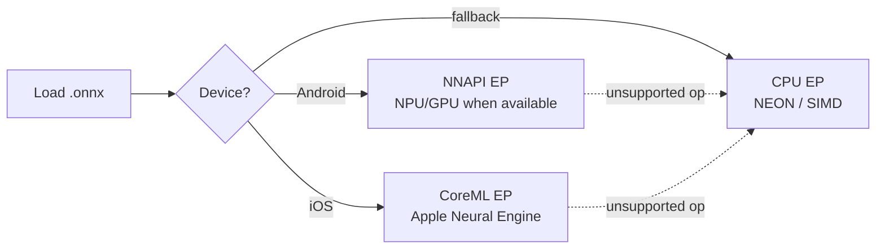
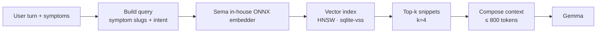
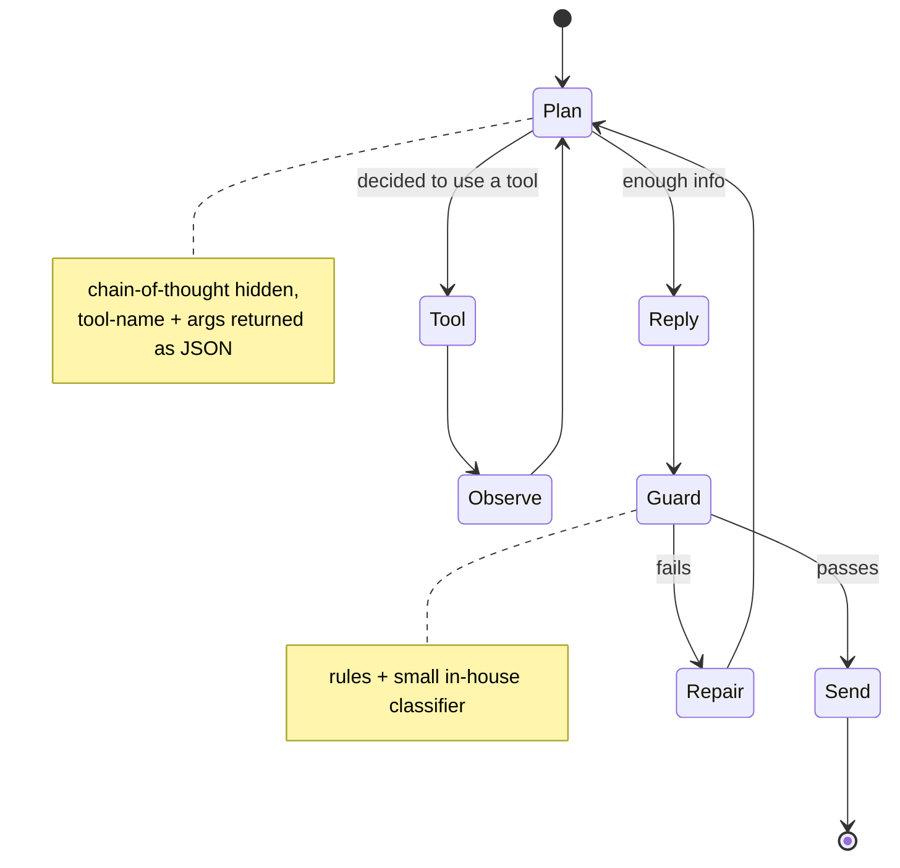
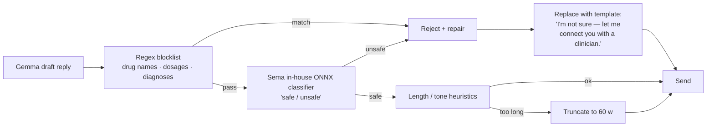

# 04 — ML + AI

How Sema understands and answers — entirely on-device.

The single inference engine is **ONNX Runtime Mobile**. Every model below
is exported to ONNX, quantized, and loaded by the same runtime. We do
**not** mix `whisper.cpp`, `llama.cpp`, or other per-model engines — one
runtime keeps the platform layer thin, lets us share threadpool/memory
arena across models, and means a contributor only needs to learn one API.

The generative core is **Gemma**, served via **MediaPipe LLM Inference**
through the `flutter_gemma` package (the one runtime exception — see
"Runtime split" below for why).

Every other stage (ASR, NLU, embedder, safety, TTS) is a **Sema in-house
ONNX model** — trained or fine-tuned on the target languages and the
clinical-content corpus, then exported and quantized.

## Pipeline at a glance

The pipeline branches once on the `LanguageRouter`'s decision: **direct**
for languages Gemma handles natively (English, French), **pivot via
English** for low-resource languages where Gemma cannot generate or
understand reliably (Swahili, Twi, Ga, Yorùbá). See the
[Language router](#language-router) section below for the rationale and
the per-language matrix.

```mermaid
flowchart LR
    MIC([User speaks]) --> VAD[VAD<br/>silence detection]
    VAD --> ASR[ASR · Sema in-house ONNX<br/>multilingual encoder + CTC]
    ASR --> ROUTE{LanguageRouter<br/>pathFor lang}

    ROUTE -- direct · en/fr --> NLU_D[NLU · in-house ONNX]
    ROUTE -- pivot · sw/aka/gaa/yo --> TR1[MT-in · in-house ONNX<br/>native → English]
    TR1 --> NLU_P[NLU · in-house ONNX]

    NLU_D --> TRI[Rule-based triage<br/>red-flag detection · pure Dart]
    NLU_P --> TRI
    TRI --> RAG[Embed + retrieve<br/>Sema in-house ONNX embedder]
    RAG --> LLM[LLM · Gemma 3n E2B<br/>flutter_gemma · MediaPipe · int4]

    LLM --> GUARD[SafetyGuard · English-side<br/>regex + in-house ONNX classifier]

    GUARD -- direct --> TTS_D[TTS · in-house ONNX<br/>+ eSpeak NG fallback]
    GUARD -- pivot --> TR2[MT-out · in-house ONNX<br/>English → native]
    TR2 --> TTS_P[TTS · in-house ONNX<br/>+ eSpeak NG fallback]

    TTS_D --> SPK([Sema replies])
    TTS_P --> SPK
```



Each box is a Dart service behind a clean interface. The model file behind
it is a versioned `.onnx` artifact — swap weights without touching the
agent.

The safety guard sits on **Gemma's English output, before any
translation-out**. Rejected content never reaches MT-out — the translator
is only ever asked to translate already-approved text.

---

## Why one runtime

| Property | Single ORT runtime | Mixed (whisper.cpp / llama.cpp / etc.) |
|---|---|---|
| Binary size | 1 native shared lib (~25 MB) | 3+ native libs |
| Memory arena | Shared across models | Per-engine |
| Threadpool | One pool, configured once | One per engine, contend with each other |
| FFI surface | One small Dart wrapper | One per engine, each with quirks |
| Quantization formats supported | int8, fp16, int4 (via QDQ) | Each engine has its own (`gguf`, `ggml`, etc.) |
| Vendor support on mobile | Microsoft, NNAPI/CoreML EPs out of the box | Manual integration |
| Hardware acceleration | NNAPI on Android, CoreML on iOS via execution providers | Engine-specific |

The runtime cost we accept: ORT's general-purpose nature is slightly
slower for some specific architectures than a dedicated runtime. For the
sizes we ship, the difference is < 15 % per turn — well within budget.

### Runtime split — one exception, deliberately

There is **one** model that does not run on ONNX Runtime: **the LLM
(Gemma) uses MediaPipe LLM Inference via `flutter_gemma`.** Reasons we
accept the second runtime:

- **Specialised performance.** MediaPipe is what Google ships, tunes,
  and benchmarks Gemma against. ONNX-Runtime-genai for Gemma is
  catching up but consistently 1.5–2× slower at int4 inference on the
  same chip.
- **Per-Layer Embeddings (PLE) for Gemma 3n.** This memory-paging
  feature only runs cleanly on MediaPipe today; it's the reason E2B
  fits in ~2 GB of active RAM on a mid-tier phone.
- **Native streaming + tool-use surface.** `flutter_gemma` exposes
  Gemma's tool-calling primitives directly; replicating that on ORT
  would mean rebuilding sampler + decoder + tool parser ourselves.
- **Cost is small.** MediaPipe adds ~30 MB of native binary. Trivial
  next to a 1.4 GB model file.

Everything else (ASR, NLU, embedder, safety classifier, TTS) stays on
ONNX Runtime, single runtime, single FFI surface.

---

## Execution providers (hardware acceleration)

ORT chooses an execution provider per model. We configure:



**Decision:** prefer hardware EP, fall back to CPU per-op rather than
per-model. ORT handles this graph partitioning automatically, so an op
that NNAPI can't run still uses CPU for that node while the rest stays on
NPU.

Per-model ops are validated in CI: a guard test fails the build if a model
update introduces an op that **all** EPs can't handle on at least one
target SKU.

---

## ASR · Speech to text

**Sema in-house ONNX ASR.**

- Architecture: streaming encoder + CTC decoder (Conformer-style or
  similar — implementation detail of the model team).
- Languages: English, French, Swahili, Twi, Ga, Yorùbá in one
  multilingual checkpoint. Language ID is decided up-front from the
  active profile setting; ASR isn't asked to detect it on every turn.
- Quantization: int8 dynamic.
- Streaming: emits partial transcripts every ~200 ms so the UI can show
  live captioning while the user is still speaking.
- Confidence per token, surfaced for the "fix this transcript" affordance.

**Quality target:** WER ≤ 25 % on noisy field recordings — Sema works
because the user can correct misrecognitions inline.

**Fallback:** if a turn returns confidence < 0.4, Sema asks "could you
say that again, or would you like to type?" — never silently
hallucinates.

---

## Language router

The router decides, per language, whether the LLM sees the user's
native text directly or whether we pivot through English. This is a
**safety decision first, performance decision second**.

### Per-language reality (Gemma 3n / Gemma 2)

| Language | Code | Gemma quality | Path |
|---|---|---|---|
| English | en | native | **Direct** |
| French | fr | strong | **Direct** |
| Swahili | sw | partial — quality unproven for medical | **Pivot** — conservative |
| Twi | aka | poor / unreliable | **Pivot** — only safe option |
| Ga | gaa | none | **Pivot** |
| Yorùbá | yo | poor | **Pivot** |

The asymmetry is real: trusting Gemma with Twi for medical advice isn't
just a quality issue, it's a safety issue. We can't audit a hallucinated
Twi reply with our English-trained safety classifier.

### Why pivot-en is the right default for low-resource languages

1. **Gemma operates in its strongest language.** No Twi/Ga/Yo
   hallucinations.
2. **Safety stays auditable.** Classifier is English-trained; pivot
   keeps it usable. Without it, Gemma's Twi reply is a black box.
3. **RAG fits cleanly.** Clinical corpus is English; Gemma reads
   English context end-to-end.
4. **Clinician review is possible.** Every Gemma input + output is in
   English — reviewable without learning the user's language.
5. **Triage rules don't care.** They operate on language-agnostic
   symptom slugs already, so this layer is unaffected by routing
   choice.

### Direct path (en, fr) — the fast path

```
audio (native)
  → ASR
  → native text
  → NLU (intent + symptom slugs)
  → Triage rules (slug-level)
  → RAG (English corpus; query built from slugs + native text)
  → Gemma (native in / native out)
  → SafetyGuard (English-trained classifier; we still sanity-check
                 native output via a small native-side regex blocklist)
  → TTS (native)
  → audio (native)
```

### Pivot path (sw, aka, gaa, yo) — the safe path

```
audio (native)
  → ASR
  → native text
  → MT-in (native → English)
  → NLU (English)
  → Triage rules (slug-level)
  → RAG (English)
  → Gemma (English in / English out)
  → SafetyGuard (English-trained classifier)        ← stops here if rejected
  → MT-out (English → native)
  → TTS (native)
  → audio (native)
```

### The router

```dart
class LanguagePath {
  final bool pivot;             // route through English?
  final String gemmaInputLang;  // 'en' or native code
  final String gemmaOutputLang; // 'en' or native code
  final String? templateBank;   // pre-translated escalation strings
}

class LanguageRouter {
  LanguagePath pathFor(String code);
}
```

Backed by `assets/lang/router.yaml`:

```yaml
en:  { pivot: false }
fr:  { pivot: false }
sw:  { pivot: true,  template_bank: emergency_sw  }
aka: { pivot: true,  template_bank: emergency_aka }
gaa: { pivot: true,  template_bank: emergency_gaa }
yo:  { pivot: true,  template_bank: emergency_yo  }
```

Editable as eval data lands. Flipping `pivot: false` for a language is a
config change, not a code change — but CI evaluation (BLEU on MT,
pass-rate on Gemma per-language) governs when a language is allowed to
flip.

---

## Translator · Bridge to/from English

**Sema in-house ONNX seq2seq translator.** Active only on the pivot path.

- Architecture: encoder–decoder transformer.
- Languages: bidirectional between English and the six supported
  languages.
- Quantization: int8 dynamic.
- **Domain-tuned.** Must be fine-tuned on health/clinical bilingual
  pairs. A general-purpose translator silently loses symptom terms.

### Quality safeguards

- **MT confidence floor.** If the translator's confidence is < 0.5,
  ask the user to repeat or type — never guess.
- **Term preservation.** Keep proper nouns, drug names, place names
  verbatim across the round-trip. Translator gets a fixed dictionary
  of preserved tokens.
- **Pre-translated templates** for safety-critical messages (red-flag
  escalations, "go to hospital now"). Free-form MT is **forbidden**
  in these paths — one mistranslation in an emergency string is one
  too many.

**Decision:** keep translation in the loop rather than fine-tune Gemma
on every target language. Smaller artifact, separable concerns, and a
clinician can audit the prompt the LLM actually sees (always English)
without learning the user's language.

---

## NLU · Intent + symptom extraction

**Sema in-house ONNX NLU model.** A small encoder doing two heads:

1. **Intent classification** — `triage`, `first_aid`, `find_care`,
   `health_record`, `medication`, `chitchat`.
2. **Symptom NER** — extracts spans like "fever", "stomach pain for 3
   days" and maps them onto the bundled symptom taxonomy (~300 entries).

**Why not just give the LLM the raw transcript?** Determinism. Triage
red-flag rules need a structured symptom list, not an LLM's
interpretation. Putting NER between ASR and the agent gives us a stable
hook for safety even when the LLM gets creative.

---

## Triage engine · The deterministic safety net

Pure Dart. No model. Reads the symptom list + age/sex/vitals from the
profile and returns:

```dart
class TriageOutcome {
  final Severity severity;       // low | medium | high | emergency
  final String recommendation;   // human-readable
  final EscalationTarget? target;// closest provider category to push to
  final double confidence;       // rule-coverage score
}
```

Rules live in `assets/triage/rules.yaml` (versioned, reviewable by a
clinician without touching code). Example fragment:

```yaml
- id: bleeding-heavy-pregnancy
  match:
    all:
      - symptom: bleeding-heavy
      - profile.is_pregnant: true
  severity: emergency
  recommendation: >-
    Heavy bleeding during pregnancy is dangerous. Please go to the
    nearest hospital now. I will help you find one.
  target: hospital
```

Every emergency rule cites a source (WHO IMCI guidelines, local ministry
of health protocols). The bundle ships with the citation set so auditors
can reproduce decisions.

---

## RAG · Retrieval over first-aid + clinical content



- **Embedder:** Sema in-house ONNX sentence encoder, int8 quantized.
  Output dim 384 (chosen for speed × quality balance).
- **Corpus:** ~2k passages — first-aid steps, IMCI summaries, common
  health concerns, drug interaction rules.
- **Index:** `sqlite-vss` (HNSW inside SQLite — keeps it in the same DB
  file, no extra runtime).

Retrieval quality is mostly about clean source text rather than embedder
size; the small in-house encoder keeps inference under 50 ms per query.

---

## LLM agent · Gemma

The LLM does **not** drive triage; it drives *expression*. By the time it
runs, severity and retrieved context are already decided.

### Model choice

| Variant | Size (int4) | Notes |
|---|---|---|
| **Gemma 3n E2B** | ~2.0 GB | Purpose-built for on-device, multimodal-ready. **Primary.** |
| Gemma 2 2B | ~1.5 GB | Reliable fallback for older NPUs that struggle with Gemma 3n's mixture-of-experts ops |
| Gemma 2 9B | (off-device only) | Used only in CI for offline evaluation of v1 prompts; never ships |

**Decision:** ship **Gemma 3n E2B int4** as primary, **Gemma 2 2B int4**
as the auto-selected fallback when the device's storage is tight or its
NPU lacks the ops Gemma 3n needs. App probes free disk + EP capabilities
at first launch and picks one — user can override in
Settings → Advanced → Model.

### Runtime

- **`flutter_gemma`** wrapping **MediaPipe LLM Inference**. The single
  exception to the "ONNX Runtime everywhere" principle (see "Runtime
  split" earlier in this doc).
- Provides KV-cache management, streaming token output, sampling
  (top-p, top-k, temperature), stop-token handling, native tool calling.
- Model format: `.task` bundle (Google's MediaPipe LLM packaging).
- Per-Layer Embeddings (PLE) on Gemma 3n keep active RAM ~2 GB on
  mid-tier phones; weights paged from disk as needed.
- Loaded once into the long-lived background isolate, kept hot.
- Idle-eviction: if the LLM hasn't been used for 10 minutes and memory
  pressure is high, weights are released; reloaded on next turn (cost
  ~2 s on warm storage).

### Agent loop



### Tools (callable from Gemma)

```dart
abstract class SemaTool {
  String get name;
  String get description;       // shown to the LLM in the system prompt
  Map<String, Schema> get args; // JSON schema for the LLM
  Future<ToolResult> call(Map<String, Object?> args);
}
```

| Tool | Purpose |
|---|---|
| `lookup_first_aid(condition)` | Returns the matching `FirstAidGuide` + first 2 steps for the LLM to phrase |
| `find_nearest_provider(role)` | Returns top 3 open providers, sorted by walk time |
| `record_symptom(slug, severity, free_text)` | Persists the structured symptom on the conversation |
| `record_vital(kind, value, unit)` | Logs a measurement on the active profile |
| `escalate(reason)` | Forces severity = emergency, surfaces red banner, suggests closest hospital |
| `clarify(question)` | Asks one short follow-up before answering |
| `set_reminder(when, title)` | Creates a `Reminder` row |

Gemma is told it **must** call `clarify` when uncertain, **never**
prescribe medication, and **always** `escalate` on red-flag symptoms.

### System prompt skeleton (truncated)

```text
You are Sema, a calm, kind health companion for families in West and East
Africa. You speak briefly and clearly. You do not diagnose. You suggest
first aid steps from the bundled guides; you point users to the closest
trusted clinician for anything serious.

Rules:
- Never name a specific medication or dosage.
- Never claim to be a doctor.
- If the user reports any of {RED_FLAGS}, call escalate(...) immediately.
- If you are unsure, call clarify(...) once. Don't guess.
- Use the tools below by emitting JSON: {"tool": "...", "args": {...}}.
- Respond in {USER_LANGUAGE}. Keep replies under 60 words.

Active profile:
- name: {{profile.name}}, relation: {{profile.relation}}, age: {{profile.age}}
- pregnant: {{profile.is_pregnant}}
- known conditions: {{profile.conditions}}

Conversation symptoms so far:
{{symptoms_bullet_list}}

Retrieved context:
{{rag_snippets}}
```

Placeholders are filled in pure Dart before the call — never via an LLM
sub-call. This is what makes the agent auditable.

---

## Safety guard · The last line

Two-stage filter on every Gemma reply, before it ever reaches the user.



- **Regex blocklist** is bundled, periodically reviewed by a clinician
  collaborator. Generated from a known drug+condition list; precise
  enough to avoid false positives on common food words.
- **Sema in-house safety classifier** is a small ONNX model trained on
  curated unsafe vs safe replies. Threshold is conservative — better to
  replace a marginal reply with a safe template than ship it.
- **Repair templates** are localized into all six languages.

---

## TTS · Voice output

**Sema in-house ONNX multilingual TTS** as primary, with **eSpeak NG**
as a permanent fallback for graceful degradation.

| Language | Engine | Notes |
|---|---|---|
| English, French, Swahili | Sema in-house ONNX | Trained voices |
| Twi, Ga, Yorùbá | Sema in-house ONNX (when ready) → eSpeak NG (until then) | Voice quality follows the data we collect |
| Any (failure path) | eSpeak NG | If an in-house voice fails to load, eSpeak takes over silently |

eSpeak ships in the APK (~8 MB) so the failure path is always present
without a download.

---

## Total on-device footprint

Sizes are int8 / int4 estimates for the in-house artifacts; exact figures
depend on the model team's quantization passes and will be tracked in
`model-manifest.json`.

| Component | Quantization | Approx. size |
|---|---|---|
| ONNX Runtime native lib (incl. genai extensions) | — | 25–35 MB |
| Sema in-house ASR (multilingual) | int8 | 200–280 MB |
| Sema in-house translator | int8 | 240–300 MB |
| Sema in-house NLU | int8 | 20–35 MB |
| Sema in-house RAG embedder | int8 | 60–100 MB |
| **Gemma 3n E2B (LLM)** | **int4** | **~2.0 GB** |
| Sema in-house safety classifier | int8 | 15–25 MB |
| Sema in-house TTS (en/fr/sw) | fp16 | 80–160 MB |
| eSpeak NG (fallback) | — | 8 MB |
| Vector index + corpus | — | 12 MB |
| **Total (typical)** | | **≈ 2.7–3.0 GB** |

Plus the Flutter app (~80 MB). Storage gate at first launch is **3.0 GB
free** — explicit consent before any download.

---

## Privacy properties

- No conversation, audio, or transcript ever leaves the device by
  default.
- Gemma, ASR, NLU, embedder, safety, TTS all run inside one ORT session
  pool in the same isolate. Weights are loaded from encrypted blobs
  (`mmap` over a per-file IV) — OS pages are encrypted on disk and
  decrypted only on access.
- Telemetry is **disabled by default**; if a user opts in to bug
  reports, they get a preview of every payload before it sends.

---

## What's deliberately deferred

- **On-device fine-tuning / LoRA personalization** — interesting but
  risky; needs a far better evaluation harness than v1 will have.
- **Federated learning across devices** — same risk, plus privacy
  framework requirements out of scope for v1.
- **Vision** (e.g. photograph a wound) — Gemma 3n's vision encoder
  exists but ties us to its disk footprint; defer until a real product
  case justifies the size.
- **Per-language Gemma fine-tunes** — translate-via-English is the v1
  contract. If a target-language fine-tune ships later, the translation
  step gets bypassed for that language by config flag.
