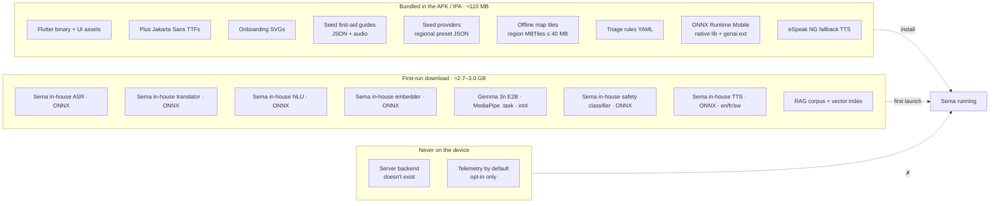
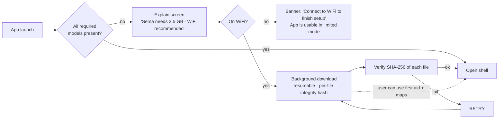
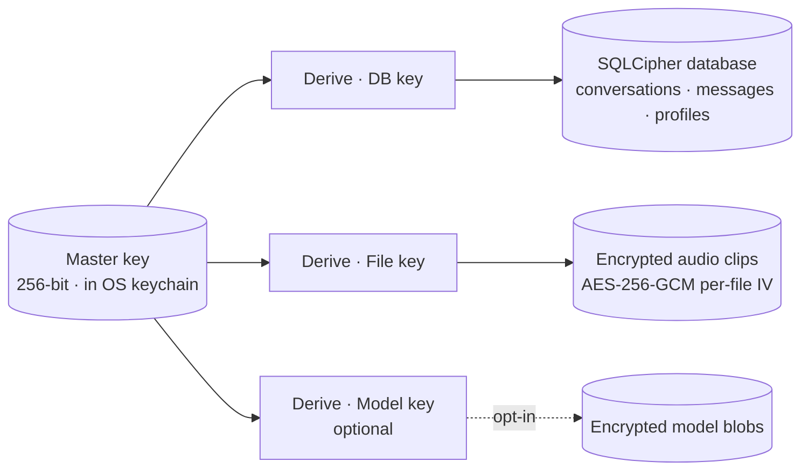
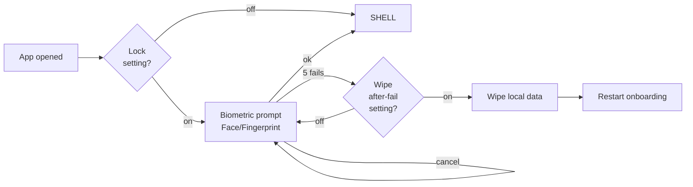
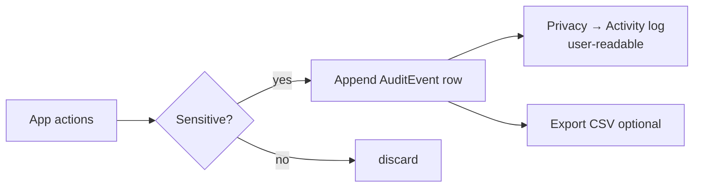

# 05 — Offline + Privacy

The two strongest constraints. Most apps treat offline as a graceful
degradation; Sema treats *online* as the unusual case. Most apps treat
privacy as a policy; Sema treats it as physics — your data is on your
phone, with no key anyone else holds.

---

## What ships in the APK vs what downloads vs what's never present

### Why split bundle vs first-run

- The Play Store / App Store rejects single artifacts > 150 MB without
  asset packs — and our model footprint is ~3 GB.
- A user updating the app shouldn't redownload 3 GB of ONNX weights every
  release. Each `.onnx` file is versioned independently in a
  `model-manifest.json` and only re-fetched when its hash changes.
- Bundling the seeds (guides, providers, tiles, rules) means the app is
  *useful* the moment install completes, even before the model download
  finishes — first aid guides work on day one with no AI involvement.

### First-run download UX

- **Resumable.** Cancellation drops back to the last completed file. A
  partial download is treated as if no download happened.
- **Verified.** Every file has a SHA-256 in the manifest baked into the
  APK. Mismatch → discard + retry.
- **Limited mode** while waiting: first aid, map, family profiles all
  work. The mic button on the home card shows "needs setup" and the user
  is sent back to the download screen if they tap.

---

## Encryption at rest

- **Master key** is generated on first launch, never leaves the OS keychain.
  iOS: `Keychain` with `kSecAttrAccessibleAfterFirstUnlockThisDeviceOnly`.
  Android: `EncryptedSharedPreferences` backed by Android Keystore.
- **DB key** is the master key passed to SQLCipher.
- **File key** is HKDF-derived; per-file AES-GCM IVs are stored on the
  message row.
- **Model encryption** is *opt-in* — adds load latency and most users
  don't need it. The threat model where someone can read raw files but not
  the keychain is narrow (rooted device, app data extracted offline). Off
  by default; settings toggle for power users.

### What this protects against

- Lost or stolen device with screen locked → encrypted; nothing readable.
- ADB pulled app data via a backup → encrypted blobs, useless without keychain.
- Malicious app on the same device with read access → still needs keychain
  unlock, gated by biometric.

### What it can't protect against

- The user voluntarily handing the phone to someone unlocked.
- A compromised OS keychain (very rare; outside our trust boundary).
- A camera over the user's shoulder.

These limits are stated in the Privacy screen so users understand what
"fully encrypted" actually means.

---

## Biometric lock

- **Default:** lock OFF. Asking for biometric every open is friction the
  median user doesn't need; opt-in via Settings → Privacy.
- **Wipe-after-N-failures:** off by default; only available if biometric
  lock is on; max attempts configurable (5–20).
- **Profile-level lock** is *not* in v1 — biometric protects the whole
  app. Adding per-profile biometric is feasible (multi-credential) but
  introduces UX complexity (a child profile probably shouldn't need
  fingerprint to open).

---

## Profile data isolation

All rows that belong to a person carry `profile_id` as a foreign key. The
data layer enforces isolation by **always parameterizing** queries on
`currentProfileProvider`. Reviews check that:

- No repository method takes "no profile" as an option (use a sentinel
  `Profile.unknown` if you must, never `null`).
- No widget reads conversation/message data without going through a
  provider that injects `profileId`.

Static analysis: a custom lint forbids raw `db.conversations.select()`
without a `.where((c) => c.profileId.equals(...))` upstream.

This is **logical** isolation, not physical. A bug *could* leak across
profiles. To compensate: an internal "profile boundary check" runs on
every conversation render and asserts the rows belong to the active
profile, screaming in debug mode if not.

---

## Audit log

Logged events:
- Profile created / deleted.
- Biometric prompt: success / failure (no biometric data, just outcome).
- Backup enabled / disabled.
- Conversation deleted by user.
- Local data wipe.

This log is for the *user*, not for telemetry. Stays on device. Can be
exported (encrypted ZIP) and shared with a doctor at the user's
discretion.

---

## Wipe paths

| Trigger | Effect |
|---|---|
| User → Settings → Privacy → Erase | DB + audio + audit log + RAG personal additions wiped. Models retained. |
| User → Settings → Privacy → Full reset | Everything above + downloaded models. Returns to first-launch state. |
| App uninstall | OS removes the data dir. Master key in keychain is also removed. |
| 5+ biometric failures *(if opted in)* | Soft wipe (DB + audio + audit). Models retained. |

A wipe is a synchronous local operation (≤ 2 s on a 100k-message DB).
There's no remote unwind, because there's no remote.

---

## Optional sync (Milestone 3 — not v1)

When/if sync ships, it will be:

- **Zero-knowledge.** The user's phone encrypts a blob; the server stores
  bytes it cannot read.
- **Passphrase-derived.** A user-chosen passphrase (Argon2id) derives the
  blob key. Lose the passphrase = lose the backup. Recovery: there is none.
- **Coarse-grained.** A nightly snapshot of the DB + audio dir, not
  per-row sync. Prevents leak vectors of partial sync.
- **Storage-agnostic.** User picks: their own Google Drive, iCloud, or a
  USB-connected computer.

**Not** part of v1 because the threat model needs more thought (e.g.
ransomware against the user's chosen storage) and v1 ships without it
just fine.

---

## Network usage report

For full transparency, here is **every** network call the app may make:

| Path | When | What |
|---|---|---|
| First-run model download | Once (or after manual update) | Plain HTTPS to a CDN, downloading versioned model blobs by hash |
| OTA OS biometric APIs | When unlocking | OS-internal; never our network |
| Map tiles refresh | If user opts into "fresh map" | HTTPS for vector tile server |
| Bug report (opt-in) | If user submits | One HTTPS POST with the previewed JSON |
| Sync (M3, opt-in) | Per schedule | One HTTPS PUT of an encrypted blob |

Every other feature — voice, AI, first aid, family, profiles — uses
**zero** network. Tested by airplane-mode integration runs in CI.
