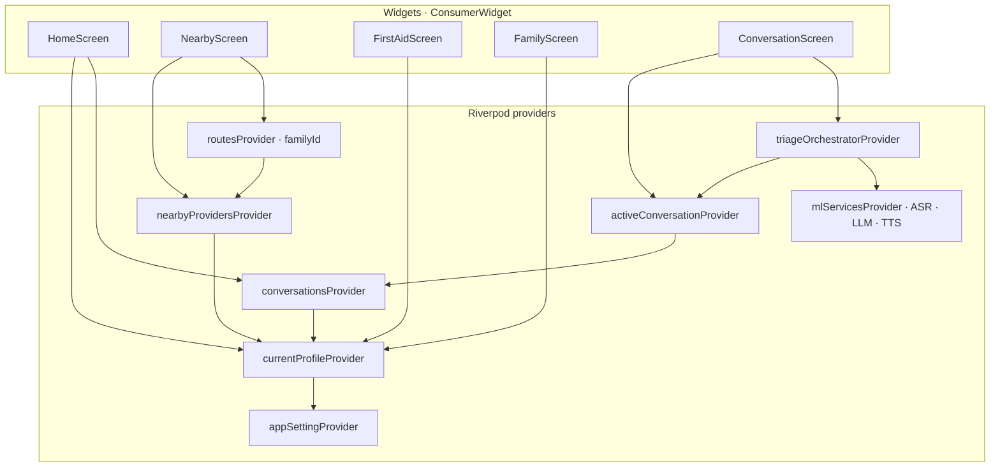
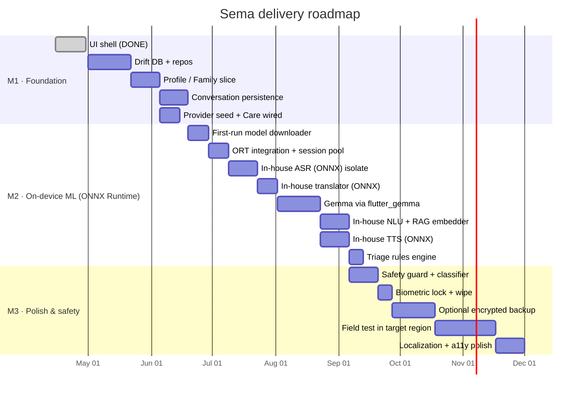

# 06 — Implementation

The concrete tech stack, where each piece lives in the repo, how state
flows, and a milestone roadmap. This is what you'd hand a new contributor.

---

## Tech stack

| Concern | Choice | Why |
|---|---|---|
| App framework | **Flutter 3.x** (Dart 3) | Already the project foundation; one codebase, both stores |
| State management | **Riverpod 2.x** | Compile-safe, reactive, no boilerplate, async-first |
| Local DB | **Drift** over **SQLCipher** | Typed query API, reactive streams, encrypted |
| Vector search | **sqlite-vss** | HNSW index inside the same SQLite file |
| Audio capture | `record` | Battle-tested, low-latency |
| Audio playback | `just_audio` | Reliable on both platforms |
| Maps | **MapLibre Native** + offline MBTiles | OSS, no token, offline-capable |
| Biometric | `local_auth` | Standard wrapper for Face/Touch ID + BiometricPrompt |
| Secure storage | `flutter_secure_storage` | Keychain / KeyStore-backed |
| HTTP (model dl) | `dio` | Resumable downloads, progress, cancellation |
| Icons | `phosphor_flutter` | Award-winning, multi-weight; already used |
| SVG | `flutter_svg` | Already used for onboarding illustrations |
| FFI to ML | `dart:ffi` + `package:ffi` | Direct C interop; isolate-friendly |
| ML runtime | **ONNX Runtime Mobile** (one engine for everything) | Single runtime for ASR/NLU/embedder/TTS/safety/LLM — shared threadpool, smaller native footprint, NNAPI/CoreML execution providers out of the box |
| LLM runtime | **`flutter_gemma`** (MediaPipe LLM Inference) | One exception to "single ONNX runtime" — Google's tuned Gemma path, supports Gemma 3n PLE, native tool calling. See [04-ml-and-ai.md](04-ml-and-ai.md#runtime-split--one-exception-deliberately). |
| TTS fallback | **eSpeak NG** | Universal fallback when an in-house voice fails to load |
| Voice routing | `LanguageRouter` + `assets/lang/router.yaml` | Per-language policy: en/fr direct to Gemma, sw/aka/gaa/yo pivot via English. See [04-ml-and-ai.md](04-ml-and-ai.md#language-router). |
| Lints | `flutter_lints` + custom rules | Already on |

### Decisions worth noting

- **Riverpod over BLoC** — BLoC is fine but ceremony-heavy for this app's
  size. Riverpod's `Notifier` + `AsyncNotifier` cover everything we need
  with less code per provider.
- **Drift over Isar** — Isar is fast and fun, but its `.isar` file format
  isn't natively encryptable. SQLCipher gives us a battle-tested encrypted
  format; Drift gives us types over it.
- **One ONNX Runtime, every model** — instead of bundling per-engine
  natives (`whisper.cpp`, `llama.cpp`, etc.), every stage exports to ONNX
  and runs on ORT. Smaller binary, shared threadpool/memory arena, one
  FFI surface, hardware acceleration via NNAPI / CoreML execution
  providers without per-engine integration. The cost is a small (≤ 15 %)
  per-turn perf hit vs a model-specific runtime — well within budget.
- **Native FFI over a Dart-only port** — `dart:ffi` is mature enough
  that the cost of bindings to ORT is negligible vs the cost of any
  pure-Dart inference path.

---

## Repo layout

```
sema-health/
├── Architecture/                      ← these docs
├── ui-patterns/                       ← reference screenshots
├── sema_health/                       ← Flutter app
│   ├── assets/
│   │   ├── fonts/                     ← Plus Jakarta Sans (bundled)
│   │   ├── illustrations/             ← onboarding SVGs (bundled)
│   │   ├── seed/                      ← first-aid, providers, triage rules
│   │   ├── lang/
│   │   │   ├── router.yaml            ← per-language routing policy
│   │   │   └── templates/             ← pre-translated escalation strings
│   │   └── tiles/                     ← regional MBTiles
│   ├── lib/
│   │   ├── main.dart
│   │   ├── theme/                     ← already exists
│   │   ├── widgets/                   ← reusable widgets
│   │   ├── screens/                   ← per-route screens
│   │   ├── data/
│   │   │   ├── seed.dart              ← already exists
│   │   │   ├── db/                    ← Drift schema + DAOs
│   │   │   ├── repos/                 ← repository implementations
│   │   │   └── stores/                ← file/secure key wrappers
│   │   ├── domain/
│   │   │   ├── entities/              ← plain Dart models
│   │   │   ├── triage/                ← rule engine
│   │   │   └── safety/                ← guard rules
│   │   ├── application/
│   │   │   ├── providers/             ← Riverpod providers (one per slice)
│   │   │   └── use_cases/             ← orchestration
│   │   ├── ml/                        ← one Dart interface per stage
│   │   │   ├── asr.dart               ← in-house ASR
│   │   │   ├── nlu.dart               ← in-house NLU
│   │   │   ├── tts.dart               ← in-house TTS
│   │   │   ├── translator.dart        ← in-house translator (pivot path only)
│   │   │   ├── embedder.dart          ← in-house embedder
│   │   │   ├── safety_classifier.dart ← in-house safety
│   │   │   ├── language_router.dart   ← per-language path resolver (router.yaml)
│   │   │   └── llm.dart               ← Gemma via genai
│   │   ├── ai/
│   │   │   ├── agent.dart             ← agent loop
│   │   │   ├── prompts/               ← localized templates
│   │   │   └── tools/                 ← one file per tool
│   │   └── platform/
│   │       ├── ort/                   ← ONNX Runtime FFI bindings + session pool
│   │       └── audio/                 ← capture/playback
│   └── pubspec.yaml
└── README.md
```

### Conventions

- **One feature, one slice.** A slice is `screens/* + application/providers/* + domain/* + data/repos/*` for the same feature. Avoid cross-slice imports unless the feature is primitive (theme, common widgets).
- **No widget imports `package:drift`.** Widgets read from providers, providers read from repos, repos own the DB.
- **No model file paths in Dart constants.** Model paths come from a
  `ModelManifest` resolved at runtime so a future "user picks lightweight
  models" setting works without refactor.

---

## State management with Riverpod



### Provider categories

- **`Provider`** — derived/synchronous values (e.g. `currentProfileAccentProvider` from `currentProfileProvider`).
- **`StreamProvider`** — DB streams (Drift gives us reactive streams for free).
- **`AsyncNotifier`** — anything with side effects + state (the
  `triageOrchestratorProvider` that runs the ASR → AI → TTS pipeline).
- **`FutureProvider.family`** — parameterized one-shots (e.g. `routesProvider(providerId)`).

### Rebuilding only what changed

- Use `select()` aggressively: `ref.watch(currentProfileProvider.select((p) => p.accentKey))` so a name-only change doesn't repaint the whole header.
- For lists, prefer `keepAlive` on stream providers if they're cheap to keep memory-resident; let Riverpod auto-dispose the rest.

---

## Replacing the current screens with a real data layer

Right now the screens hold demo data inline. Migration plan:

| Screen | Today | After |
|---|---|---|
| `HomeScreen` | Hardcoded recent tiles | `recentConversationsProvider(profileId)` |
| `ConversationScreen` | Hardcoded `_msgs` list | `messagesProvider(conversationId)` |
| `NearbyScreen` | Static `_providers` const | `nearbyProvidersProvider(currentProfileId)` |
| `FirstAidScreen` | Static `firstAidEntries` | `firstAidGuidesProvider` (still bundled, but via repo) |
| `FamilyScreen` | Static `_members` | `householdProvider(deviceId)` |
| `LanguagePickerScreen` | Picker UI complete | On Continue: `setProfileLanguage(...)` use case |

Order: `Profile/Family` first (everything else depends on it), then
`Conversation`, then `Care`, then `First aid`.

---

## Build configuration

- **Asset packs** for stores that support them (Android Asset Delivery).
  Models *not* in the APK; downloaded post-install.
- **Native libraries** are arch-specific (`arm64-v8a`, `armeabi-v7a` for
  Android; `arm64`, `x86_64` for iOS simulator). Built in CI, signed,
  cached by hash.
- **Versioning** — semver for the app; *separate* `model-manifest.json`
  versioning for ML weights. App version 1.4.x can require model manifest
  ≥ 3 — the runtime checks and prompts an upgrade if mismatched.

---

## Testing strategy

| Layer | Tools | What we test |
|---|---|---|
| Domain | `test` | Triage rule engine (golden YAML cases), safety guard regex/classifier |
| Data | `drift_dev`, `test`, `sqflite_common_ffi` | Repos against an in-memory DB |
| Application | `riverpod_test` | Provider state transitions per use case |
| Widgets | `flutter_test` + golden tests | Hero cards, chip strips, navigation card states |
| Integration | `integration_test` | Onboarding → home → conversation, in airplane mode |
| ML | scripted | Per-language WER on bundled clips; LLM eval against red-flag prompts |

A particularly important test: **airplane-mode CI run**. The integration
suite enables airplane mode, walks through onboarding, opens a
conversation, plays an audio fixture, and asserts a sensible Sema reply.
If we ever accidentally introduce a network dependency, this test fails.

---

## Roadmap · milestones



Order is approximate. Two principles drive sequencing:

1. **Earliest useful slice.** First aid + maps work on day one; we don't
   need ML to ship something useful.
2. **Highest-risk pieces, second.** ML integration via FFI is the riskiest
   work. Start it as soon as the data layer can hold its outputs.

---

## Open questions

These are decisions deferred until we have data or stakeholder input.

1. **Twi/Ga/Yorùbá voice quality.** Production-quality in-house voices
   for these depend on the data we collect. Plan: ship eSpeak NG fallback
   in v1; revisit per-language as the in-house TTS team's recordings land.
2. **Provider data sourcing.** v1 seeds from a curated regional preset.
   Long-term: partner with NGOs / ministries of health for an authoritative
   list.
3. **Triage liability.** Even with disclaimers, recommending "go to the
   hospital" wrongly (false negative) is a real harm. Will have a clinician
   reviewer before any field deployment, and the triage rules YAML will be
   reviewable by them without engineering changes.
4. **Storage budget on entry phones.** ~3 GB is a lot. Stretch goal: a
   "lite" profile that swaps Gemma 3n for Gemma 2 2B int4 (~1.5 GB) and
   trims the in-house ASR/translator/TTS to the three biggest target
   languages — gets total footprint under ~1.6 GB.
5. **Phone ↔ phone family handoff.** A family on two phones probably wants
   the same profiles. Sync (M3+) addresses it; until then, one device per
   household.

---

## Where to look first if something feels wrong

| Symptom | Most likely culprit | Open this |
|---|---|---|
| App slow during ASR/LLM | Inference on UI thread | `lib/ml/` + `lib/platform/ort/` — confirm session pool runs in the background isolate |
| Wrong color across screens | Token override | `lib/theme/tokens.dart` |
| Profile leak across conversations | Missing `where` on `profileId` | `lib/data/repos/conversation_repo.dart` |
| Network call made while offline | Forgotten future call | `analytics_optin` flag, or unstubbed model loader |
| Battery drain | ORT session not unloaded | Idle-timer in `mlServicesProvider` (evicts Gemma after 10 min idle) |
